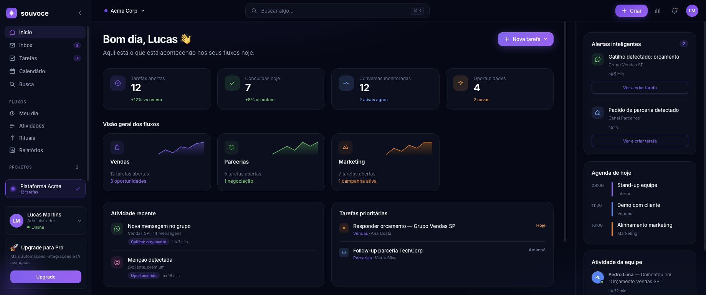
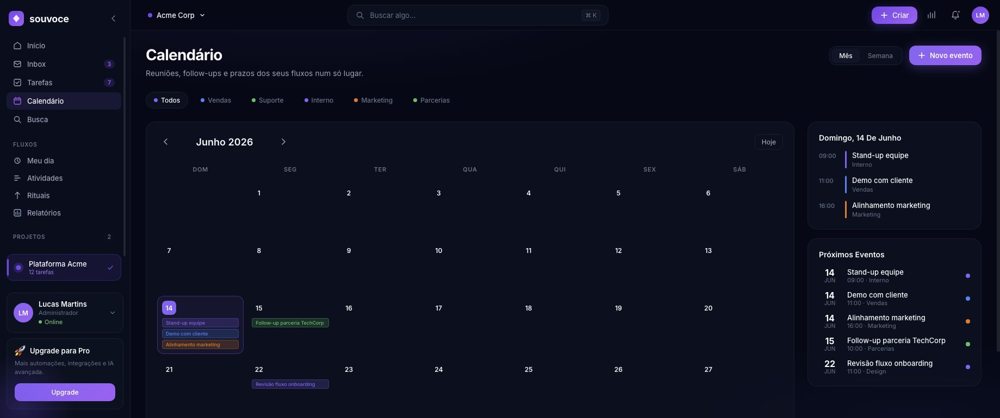
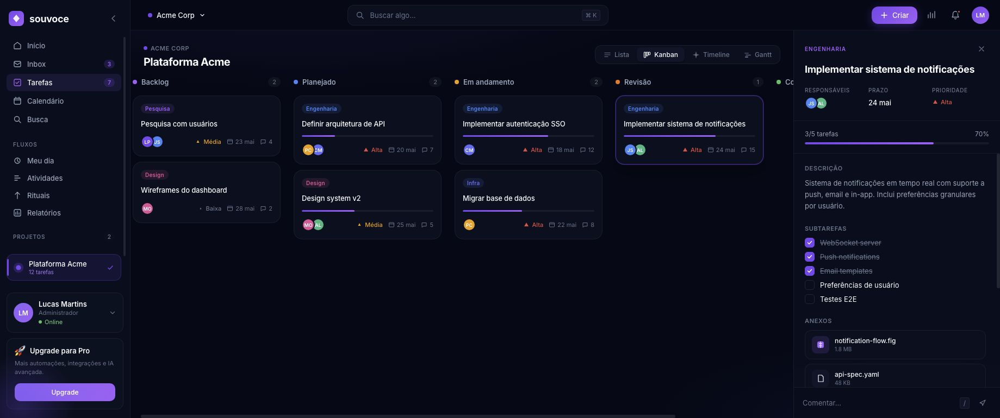

# Souvoce

Dashboard SaaS para organizar tarefas, fluxos, projetos, calendário e atividades de equipes em um único espaço de trabalho.

> Interface em português, com tema escuro e foco em produtividade, automações e acompanhamento de operações.

## Visão geral

O Souvoce reúne as principais rotinas de uma equipe em uma experiência única:

- dashboard com indicadores, agenda, alertas e atividade recente;
- tarefas em modos Lista, Kanban, Timeline e Gantt;
- calendário com eventos por fluxo e próximos compromissos;
- inbox, busca global, Meu dia e acompanhamento de atividades;
- projetos, rituais e relatórios;
- área de autenticação com login, cadastro e recuperação de acesso;
- layout responsivo com sidebar, topbar e navegação mobile.

## Screenshots

### Dashboard



### Calendário



### Tarefas



## Stack

- [Nuxt 4](https://nuxt.com/)
- [Vue 3](https://vuejs.org/)
- TypeScript
- CSS customizado
- Vite

## Como executar

Requisitos: Node.js 18 ou superior e npm.

```bash
cd frontend
npm install
npm run dev
```

O ambiente de desenvolvimento ficará disponível em [http://localhost:3000](http://localhost:3000).

## Scripts disponíveis

Executar dentro de `frontend/`:

```bash
npm run dev       # inicia o servidor de desenvolvimento
npm run build     # gera o build de produção
npm run preview   # visualiza o build de produção localmente
npm run generate  # gera uma versão estática
```

## Rotas principais

| Rota | Descrição |
| --- | --- |
| `/` | Dashboard principal |
| `/tasks` | Gestão de tarefas e projetos |
| `/calendar` | Calendário de eventos |
| `/inbox` | Caixa de entrada |
| `/myday` | Meu dia |
| `/activities` | Atividades da equipe |
| `/rituals` | Rituais recorrentes |
| `/reports` | Relatórios |
| `/search` | Busca global |
| `/auth/login` | Login |

## Estrutura

```text
.
├── frontend/
│   ├── app/
│   │   ├── components/  # componentes por domínio
│   │   ├── composables/ # estado e dados reutilizáveis
│   │   ├── layouts/     # layouts autenticado e de autenticação
│   │   ├── pages/       # páginas e rotas Nuxt
│   │   └── assets/      # estilos globais
│   ├── public/          # arquivos públicos e screenshots
│   ├── package.json
│   └── nuxt.config.ts
└── README.md
```

## Estado atual

O projeto contém uma experiência de frontend completa com dados demonstrativos locais, pronta para integração com APIs, autenticação persistente e serviços externos.

